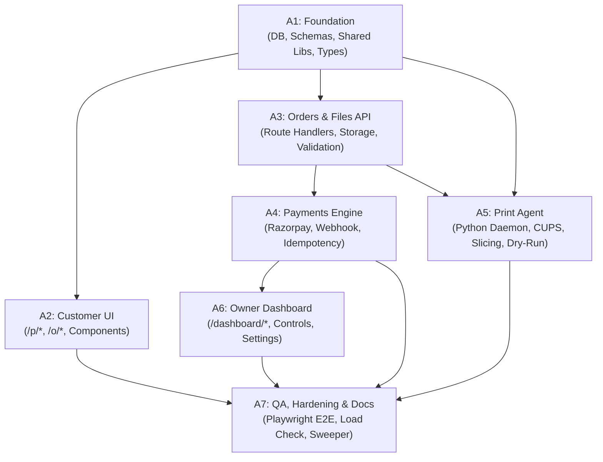

# Agent Tasks & Workstream Breakdown - QR Print Kiosk (QRLY)

## 1. Overview & Workstream Principles
To ensure modularity and clean execution, development is structured into 7 distinct tasks (A1 through A7). Each task operates within well-defined directory boundaries and depends on established contracts.

---

## 2. Task Definitions

### 2.1 Task A1: Foundation & Shared Core
- **Owner**: Foundation Engineer
- **Scope & Directories**:
  - `package.json`, `tsconfig.json`, `tailwind.config.ts`, `components.json`
  - `.env.example` with complete configuration documentation
  - `src/lib/types/`: Database and domain TypeScript types
  - `src/lib/pricing/calculatePrice.ts`: Pure pricing calculation engine
  - `src/lib/parser/parsePageRange.ts`: Strict page range validation and parsing
  - `src/lib/errors/`: Standard API error constructors
  - `supabase/migrations/0001_init.sql`: Complete DDL schema and RLS policies
  - `supabase/seed.sql`: Initial seed data (default demo shop and owner)
  - Unit tests in `src/lib/__tests__/` (100% coverage on pricing and page range)
- **Dependencies**: None.
- **Exit Criteria**:
  - `npm run dev` boots cleanly.
  - Supabase migrations apply without errors on fresh Postgres instance.
  - All unit tests for price calculations and page range parsing pass.

### 2.2 Task A2: Customer Mobile UI
- **Owner**: Frontend UI Engineer
- **Scope & Directories**:
  - `src/app/p/[slug]/page.tsx`: File upload screen
  - `src/app/p/[slug]/options/page.tsx`: Print options selector
  - `src/app/p/[slug]/review/page.tsx`: Order summary and Razorpay launch
  - `src/app/o/[orderId]/page.tsx`: Live order status, token, and verified deletion notice
  - `src/components/customer/`: Reusable components (`PrinterStatusBadge`, `FileCard`, `OptionToggleCard`, `PageRangeInput`, `StickyPayBar`, `StatusStepper`)
  - Integration with `pdfjs-dist` for client-side thumbnail rendering and early page preview
- **Dependencies**: A1 (Shared types and parsers).
- **Exit Criteria**:
  - Mobile layout verified at 360 px viewport width with zero overflow.
  - Interactive upload, options toggle, and review screens functioning against API routes or mock endpoints.

### 2.3 Task A3: Orders & Files API
- **Owner**: Backend Route Engineer
- **Scope & Directories**:
  - `src/app/api/shops/[slug]/route.ts`
  - `src/app/api/orders/route.ts`
  - `src/app/api/orders/[id]/files/route.ts`
  - `src/app/api/orders/[id]/files/[fileId]/complete/route.ts`
  - `src/app/api/orders/[id]/files/[fileId]/route.ts`
  - `src/app/api/orders/[id]/checkout/route.ts`
  - `src/app/api/orders/[id]/route.ts`
  - Server-side PDF validation and page counting using `pdf-lib` / `pdf-parse`
  - Supabase Storage signed upload/download URL integration
- **Dependencies**: A1.
- **Exit Criteria**:
  - Zod schemas validate all inputs.
  - Server strictly recounts pages and recalculates prices.
  - API integration tests pass for valid and invalid file uploads and option updates.

### 2.4 Task A4: Payments & Webhooks
- **Owner**: Payments Engineer
- **Scope & Directories**:
  - `src/app/api/webhooks/razorpay/route.ts`
  - `src/lib/payments/razorpay.ts`: SDK client, order creation, refund handler
  - Webhook HMAC SHA-256 raw signature verification
  - Idempotency handler via `payment_events` table
  - Atomic transaction: move order to `paid`, assign token, generate `print_jobs`, set `queued`
- **Dependencies**: A1, A3.
- **Exit Criteria**:
  - Webhook replay test: 5 duplicate events produce exactly 1 paid order and 1 set of jobs.
  - Tampered HMAC signatures return 400.
  - Amount mismatch triggers security alert and blocks job queueing.

### 2.5 Task A5: Print Agent Daemon
- **Owner**: Hardware / Systems Engineer
- **Scope & Directories**:
  - `print-agent/agent.py`: Main polling loop, claim handler, and job executor
  - `print-agent/config.py`: Environment variable and YAML config loader
  - `print-agent/preprocessor.py`: `qpdf` page range slicing & Ghostscript DeviceGray conversion
  - `print-agent/spooler.py`: CUPS `lp` (Linux/macOS) and SumatraPDF (Windows) command dispatchers
  - `print-agent/probe.py`: Hardware discovery script (`tools/probe_printer`)
  - `print-agent/systemd/printagent.service`: Production systemd unit file
  - `print-agent/requirements.txt`: Python dependencies (`requests`, `pyyaml`, `pydantic`)
  - Dry-run verification mode (`PRINT_DRY_RUN=true`) saving to `print-agent/out/`
- **Dependencies**: A1, A3 (Claim API contract).
- **Exit Criteria**:
  - Pytest test suite passes.
  - Dry-run mode produces verified grayscale PDFs with correct page ranges.
  - Temporary files and markers are purged in `finally` block.

### 2.6 Task A6: Shop Owner Dashboard
- **Owner**: Full-Stack Dashboard Engineer
- **Scope & Directories**:
  - `src/app/dashboard/login/page.tsx`
  - `src/app/dashboard/page.tsx`: Telemetry overview and pause toggle
  - `src/app/dashboard/jobs/page.tsx`: Realtime jobs table with reprint/refund actions
  - `src/app/dashboard/settings/page.tsx`: Price configuration & agent key rotation
  - `src/app/dashboard/qr/page.tsx`: High-res QR code generator & print sheet
  - `src/app/api/dashboard/*`: Authenticated route handlers
- **Dependencies**: A1, A4.
- **Exit Criteria**:
  - RLS policies verify owners can only access their own shop data.
  - Reprint button re-queues failed jobs; refund button successfully calls Razorpay API.

### 2.7 Task A7: QA, Hardening & Maintenance
- **Owner**: QA & Reliability Engineer
- **Scope & Directories**:
  - `src/app/api/cron/sweep/route.ts`: Expired order purge and stuck job watchdog
  - `tests/e2e/`: Playwright end-to-end tests covering complete customer-to-print lifecycle
  - `tests/load/`: Concurrency test simulating 20 simultaneous orders
  - `docs/DEBUGGING.md`, `README.md`, `docs/PRINTER_SETUP.md`
- **Dependencies**: All preceding tasks.
- **Exit Criteria**:
  - All unit, integration, and Playwright tests pass cleanly.
  - Zero leftover storage files after sweeper test execution.

---

## 3. Communication & Integration Protocol
1. **Contract Stability**: No agent may modify API schemas in `docs/API.md` or DB DDL in `docs/SCHEMA.sql` without recording the rationale in `docs/DECISIONS.md`.
2. **Integration Stubs**: If an agent requires an endpoint not yet merged, it must program against a documented mock interface and register a `TODO(integration)` entry in `docs/INTEGRATION_TODO.md`.
3. **Artifact Reporting**: Each task reports completion with an Antigravity Artifact containing test execution logs, terminal output, and screen evidence.

---

## 4. Open Questions
1. *Concurrent Test Execution*: Can Playwright and Python pytest suites run simultaneously in CI without port collisions? (Yes, by allocating distinct mock ports).
2. *Local Storage Mocking*: For unit testing file uploads in Task A3, should we use Supabase local Docker container or an S3-compatible mock? (Supabase CLI local development container recommended).
