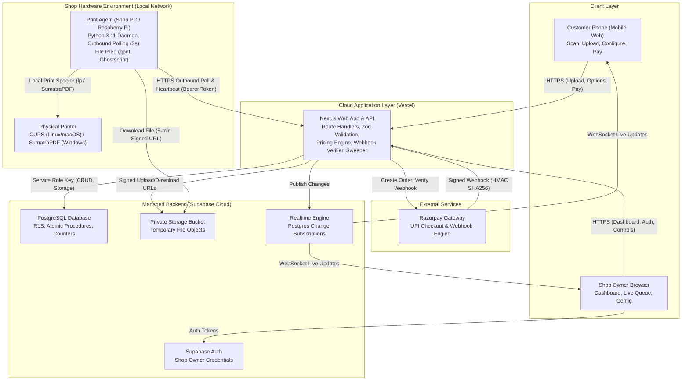
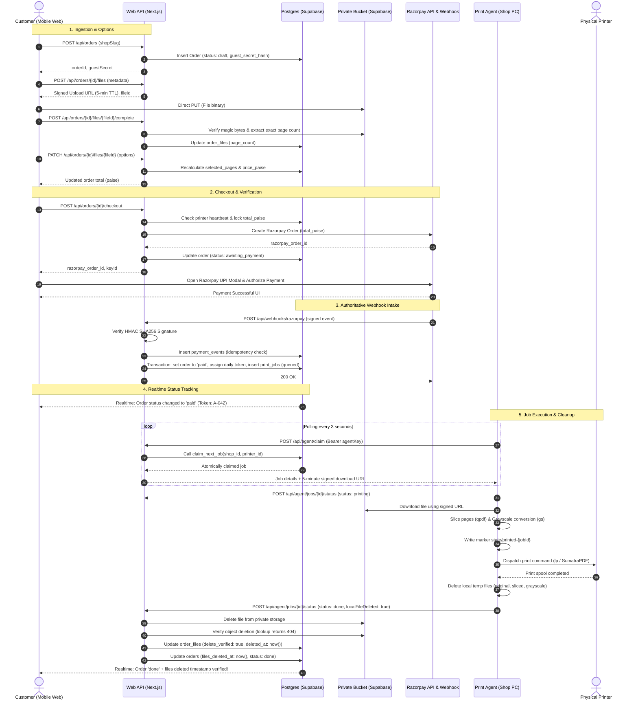
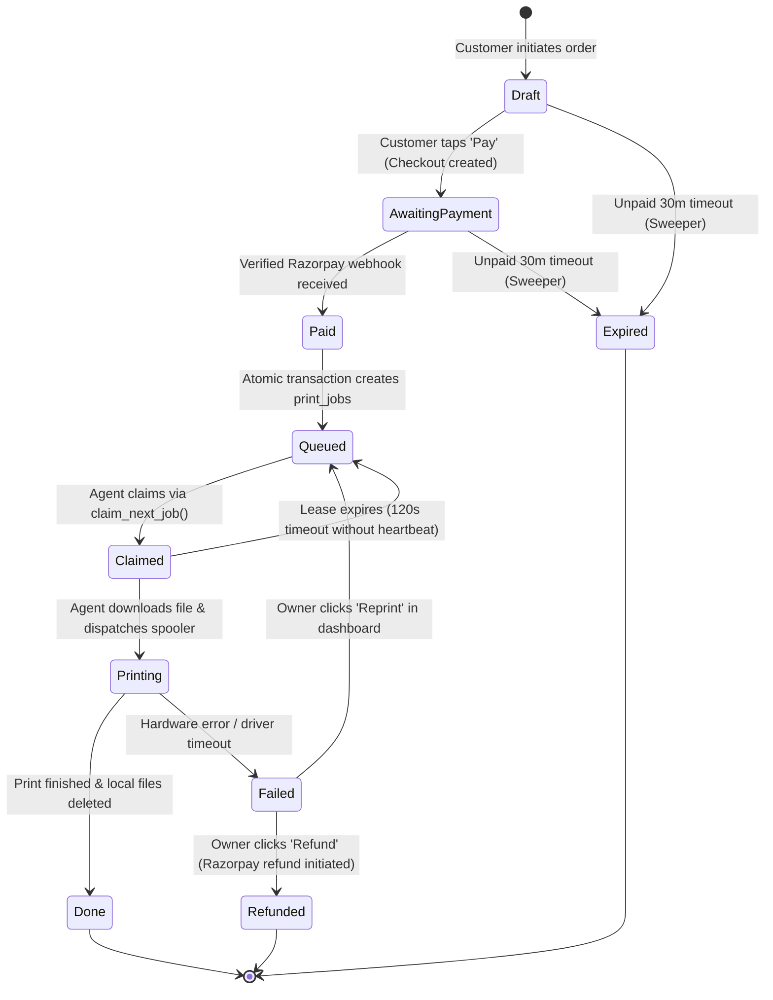

# System Architecture - QR Print Kiosk (QRLY)

## 1. System Overview & Component Diagram

The QR Print Kiosk platform consists of seven decoupled components designed for high security, zero incoming port exposure at the print shop, and atomic state synchronization between web clients and physical hardware.



### Key Architectural Boundaries
1. **Zero Inbound Ports on Shop Network**: The print shop PC/Pi resides behind typical NAT/routers. It **never** exposes an open port or web server. All communication between the print agent and cloud infrastructure happens via outbound HTTPS requests to `/api/agent/*`.
2. **Untrusted Client Boundary**: Customer browsers never talk directly to Postgres or cloud storage without signed, time-limited tokens. Prices, page counts, and state transitions are strictly governed by the Next.js API layer.
3. **Storage Isolation**: The Supabase Storage bucket `uploads` is strictly private. Files can only be uploaded and downloaded via short-lived signed URLs (5-minute TTL).
4. **Authority Separation**: The database tables have Row Level Security (RLS) enabled. The Supabase `anon` public key has zero table permissions. Server route handlers interact using the privileged `service_role` key, which is kept entirely server-side.

---

## 2. Order and Payment Sequence Flow

The end-to-end lifecycle guarantees that no document can ever reach the printer without a cryptographically verified Razorpay payment.



---

## 3. Order and Job State Machine

State transitions are strictly unidirectional and enforced by database check constraints and atomic transactions.



### Detailed State Invariants
- **`Draft`**: Order metadata created, files are being uploaded and configured. Total price is mutable.
- **`AwaitingPayment`**: Razorpay order created, total price is locked. No changes to order files permitted.
- **`Paid`**: Webhook signature and amount verified. Daily shop token (e.g., `A-042`) assigned atomically.
- **`Queued`**: Individual `print_jobs` rows exist for every file. Awaiting print agent pickup.
- **`Claimed`**: Leased by an active print agent for 120 seconds (`claim_expires_at`).
- **`Printing`**: Print agent has acquired the binary, prepared pages, and submitted to CUPS / SumatraPDF.
- **`Done`**: Physical printing completed, local temp files purged, cloud storage object verified deleted.
- **`Failed`**: Agent encountered an unrecoverable printer error or crash. Awaits owner intervention.
- **`Refunded`**: Owner issued a refund via Razorpay API; order marked closed.
- **`Expired`**: Draft or unpaid order exceeded 30 minutes; storage files deleted by the sweeper.

---

## 4. Subsystem Details

### 4.1 Next.js App Router Web Application
- **Role**: Central coordinator for customer web pages, owner dashboard, and backend route handlers.
- **Validation**: All incoming payloads are parsed and sanitized via Zod schemas.
- **Pricing Calculation**: Centralized pure TypeScript function `calculatePrice` shared by all routes.
- **Realtime Dispatch**: Relies on Supabase Realtime to broadcast row-level changes on `orders` and `print_jobs` to connected browser clients.

### 4.2 Database & Storage (Supabase Postgres)
- **Concurrency Control**: Job claiming uses Postgres row-level locks via `FOR UPDATE SKIP LOCKED` inside a PL/pgSQL function (`claim_next_job`), guaranteeing that concurrent agents can never claim the same job twice.
- **Row Level Security (RLS)**:
  - Tables: `shops`, `printers`, `shop_counters`, `orders`, `order_files`, `print_jobs`, `payment_events`.
  - Public anonymous key has zero select/insert/update/delete permissions on all tables.
  - Shop owners authenticate via Supabase Auth and can only read/mutate records where `shop.owner_id = auth.uid()`.
- **Private Storage Bucket**:
  - Bucket name: `uploads`.
  - Stored paths follow convention: `{shopId}/{orderId}/{fileId}.pdf`.
  - Direct download forbidden; requires signed URL generation with 5-minute expiry.

### 4.3 Outbound Print Agent (Python 3.11)
- **Host System**: Windows, Linux (Debian / Ubuntu), or Raspberry Pi OS (Debian-based).
- **Daemon Lifecycle**: Runs as a systemd service (Linux) or Scheduled Task (Windows) with automatic restart on failure.
- **File Pre-processing Pipeline**:
  1. Validates downloaded PDF structure using `qpdf --check`.
  2. Extracts requested page range using `qpdf --pages <input> <range> -- <output>`.
  3. If Color Mode is `bw`, runs Ghostscript to convert PDF to pure DeviceGray:
     ```bash
     gs -sDEVICE=pdfwrite -dColorConversionStrategy=/LeaveColorUnchanged -dProcessColorModel=/DeviceGray -dCompatibilityLevel=1.4 -dNOPAUSE -dBATCH -sOutputFile=<gray_output> <input>
     ```
  4. Writes idempotency marker file: `state/printed-{jobId}`.
  5. Dispatches print command to CUPS `lp` or SumatraPDF.
  6. Purges all temporary files in a `finally` block and reports `localFileDeleted: true`.

---

## 5. Open Questions
1. *Agent Heartbeat Sensitivity*: Is 15 seconds heartbeat frequency and 45 seconds offline threshold optimal for flaky retail Wi-Fi networks, or should we allow a configurable grace period?
2. *Realtime Fallback*: In environments where corporate or college Wi-Fi blocks WebSocket connections, should the client fall back to HTTP short-polling every 3 seconds for `/o/{orderId}`? (Decision: Yes, customer status page should feature an automatic polling fallback if WebSocket connection fails).
3. *Multi-File Print Order*: When an order has multiple files, should the agent print them sequentially in one batch or claim them one by one? (Decision: Claim per file via `print_jobs`, but keep them grouped under the order token).
