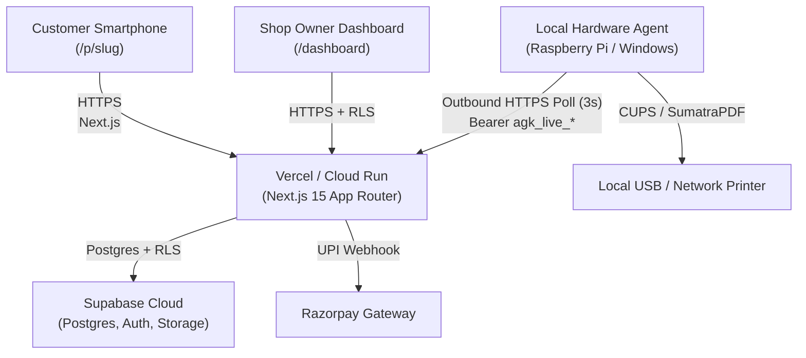

# Production Deployment & Go-Live Guide - QR Print Kiosk (QRLY)

## 1. System Overview & Architecture

QRLY is a privacy-first, zero-touch QR printing kiosk solution designed for self-serve printing at retail counters and stationery shops.



---

## 2. Infrastructure Setup & Prerequisites

### 2.1 Supabase Project Provisioning
1. Create a new project in [Supabase Management Console](https://supabase.com).
2. Navigate to **SQL Editor** and execute:
   - [`supabase/migrations/0001_init.sql`](../supabase/migrations/0001_init.sql)
   - Apply [`supabase/seed.sql`](../supabase/seed.sql) if you need a initial demonstration shop.
3. Verify that Row Level Security (RLS) is enabled on all tables:
   ```sql
   select tablename, rowsecurity from pg_tables where schemaname = 'public';
   ```
4. Navigate to **Storage** and create a private bucket named `order-documents`:
   - Set public access to **False** (private).
   - Max file size: 25 MB.
   - Allowed MIME types: `application/pdf`, `image/jpeg`, `image/png`.

### 2.2 Razorpay Payment Gateway Provisioning
1. Create an account at [Razorpay Dashboard](https://dashboard.razorpay.com).
2. Generate API Keys:
   - For testing: use `rzp_test_...` key ID and secret.
   - For production: complete KYC and use `rzp_live_...` key ID and secret.
3. Configure Webhook:
   - **URL**: `https://<your-domain>/api/webhooks/razorpay`
   - **Secret**: Generate a high-entropy secret string and save as `RAZORPAY_WEBHOOK_SECRET`.
   - **Active Events**:
     - `payment.captured`
     - `order.paid`
     - `payment.failed`

---

## 3. Web Application Deployment (Vercel)

### 3.1 Environment Variables Checklist
Configure the following environment variables in Vercel Project Settings:

| Variable Name | Environment | Description |
| :--- | :--- | :--- |
| `NEXT_PUBLIC_APP_URL` | Production | Canonical domain (e.g. `https://qrly.in`) |
| `NEXT_PUBLIC_SUPABASE_URL` | Production | Supabase HTTPS API URL (`https://<id>.supabase.co`) |
| `NEXT_PUBLIC_SUPABASE_ANON_KEY` | Production | Supabase public anonymous API key |
| `SUPABASE_SERVICE_ROLE_KEY` | Production | Privileged service role key (Never leak to client) |
| `NEXT_PUBLIC_RAZORPAY_KEY_ID` | Production | Public Razorpay key ID (`rzp_live_...`) |
| `RAZORPAY_KEY_SECRET` | Production | Private Razorpay key secret |
| `RAZORPAY_WEBHOOK_SECRET` | Production | Webhook signature verification secret |
| `CRON_SECRET` | Production | Secret token for `/api/cron/sweep` maintenance worker |

### 3.2 Scheduled Sweeper Cron Setup
Add a cron job in `vercel.json`:
```json
{
  "crons": [
    {
      "path": "/api/cron/sweep",
      "schedule": "*/5 * * * *"
    }
  ]
}
```
The sweeper runs every 5 minutes to:
- Expire unpaid draft orders and delete unreferenced files.
- Fail stuck printing jobs (> 10 minutes) with `AGENT_TIMEOUT`.
- Flag silent printers (> 45s heartbeat) as offline.

---

## 4. Hardware Print Agent Deployment

The print agent runs as a zero-inbound daemon on a Raspberry Pi or Windows computer connected to the printer via USB or local network.

### 4.1 System Dependencies
- Python 3.9+
- Ghostscript (`gs` command available on PATH)
- QPDF (`qpdf` command available on PATH)
- CUPS (Linux/macOS) or SumatraPDF (Windows)

### 4.2 Linux (Raspberry Pi / Debian) Installation
1. Clone the repository and configure virtual environment:
   ```bash
   cd /opt/qrly/print-agent
   python3 -m venv venv
   source venv/bin/activate
   pip install -r requirements.txt
   ```
2. Configure `config.yaml`:
   ```yaml
   server_url: "https://qrly.in"
   agent_key: "agk_live_xxxxxxxxxxxxxxxxxxxxxx"
   printer_name: "EPSON_L3250_Series"
   dry_run: false
   poll_interval_sec: 3
   heartbeat_interval_sec: 15
   ```
3. Install and start systemd service:
   ```bash
   sudo cp systemd/printagent.service /etc/systemd/system/
   sudo systemctl daemon-reload
   sudo systemctl enable printagent
   sudo systemctl start printagent
   sudo systemctl status printagent
   ```

### 4.3 Windows Deployment
1. Install [SumatraPDF](https://www.sumatrapdfreader.org/) to `C:\Program Files\SumatraPDF\SumatraPDF.exe`.
2. Install [Ghostscript](https://ghostscript.com/) and [QPDF](https://github.com/qpdf/qpdf/releases) and add to PATH.
3. Configure `config.yaml` with the exact Windows printer name (e.g., `EPSON L3250 Series`).
4. Set up Windows Task Scheduler to run `python agent.py` at system boot.

---

## 5. Pre-Flight Go-Live Checklist

| # | Check Item | Verification Method | Status |
| :- | :--- | :--- | :-: |
| 1 | **Integer Currency Mandate** | Zero floating point numbers in DB schema or price calculation engine | Verified |
| 2 | **Server Page Count Authority** | PDF page counts verified with `pdf-lib` / Ghostscript; browser values untrusted | Verified |
| 3 | **Zero Open Ports at Kiosk** | Agent communicates exclusively via outbound HTTPS; no router port forwards required | Verified |
| 4 | **Cryptographic File Purge** | Files deleted immediately upon print done with 404 verification receipt | Verified |
| 5 | **Payment Idempotency** | Webhook deduplication via `payment_events` unique constraint | Verified |
| 6 | **Emergency Pause Switch** | Owner `/dashboard` pause button blocks new customer uploads instantly | Verified |
| 7 | **Crash Recovery** | Marker `state/printed-<id>` prevents duplicate prints if agent restarts mid-job | Verified |
| 8 | **Sweeper Watchdog** | Sweeper cleans up stuck or expired orders every 5 minutes | Verified |
| 9 | **Test Suite Gate** | 12 Vitest suites (62 tests) + 12 Python agent tests passing with 0 failures | Verified |
