# Stepwise Execution Plan - QR Print Kiosk (QRLY)

## 1. Overview & Phased Roadmap

Execution proceeds in strict sequential phases. Progression to a subsequent phase requires passing all verification checks for that phase and posting an Antigravity Artifact containing verifiable logs, test reports, and visual evidence.

```mermaid
flowchart LR
    P0["Phase 0\nPlanning & Docs"] --> P1["Phase 1\nFoundation (A1)"]
    P1 --> P2["Phase 2\nUpload & Options (A2, A3)"]
    P2 --> P3["Phase 3\nPayments Test Mode (A4)"]
    P3 --> P4["Phase 4\nPrint Agent Dry-Run (A5)"]
    P4 --> P5["Phase 5\nPhysical Printer Test"]
    P5 --> P6["Phase 6\nOwner Dashboard (A6)"]
    P6 --> P7["Phase 7\nHardening & Load (A7)"]
    P7 --> P8["Phase 8\nDeploy & Go-Live"]
```

---

## 2. Phase Deliverables & Checkpoints

### Phase 0: Planning & Technical Specifications
- **Objective**: Establish complete architecture, API contracts, schema DDL, UI specifications, security models, and verification plans before writing application code.
- **Deliverables** in `/docs`:
  - `PRD.md`: Full product requirements and scope.
  - `ARCHITECTURE.md`: Component topology, state machines, and sequence flows with Mermaid diagrams.
  - `SCHEMA.sql`: PostgreSQL DDL, atomic procedures, and RLS policies.
  - `API.md`: Zod request/response specifications and error codes.
  - `UI_SPEC.md`: Responsive mobile-first UI wireframe specs and component guidelines.
  - `AGENT_TASKS.md`: Workstream isolation and subagent boundaries.
  - `EXECUTION_PLAN.md`: Phase progression and checkpoint definitions.
  - `TEST_PLAN.md`: Test matrix covering edge cases and verification commands.
  - `DEBUGGING.md`: 8-step order tracing methodology and symptom-fix guide.
  - `SECURITY.md`: Zero-trust architecture, upload guards, and verified deletion proofs.
  - `PRINTER_SETUP.md`: Hardware setup instructions for CUPS and Windows.
  - `DECISIONS.md`: Log of technical architectural decisions.
- **Checkpoint 0**: Human review and explicit approval of all planning documents.

---

### Phase 1: Foundation & Shared Core (Task A1)
- **Objective**: Initialize project repository, configure tooling, establish Supabase database schema, and implement core shared libraries.
- **Deliverables**:
  - Next.js 15+ App Router TypeScript project initialization.
  - Tailwind CSS, shadcn/ui component system setup.
  - `.env.example` with comprehensive variable descriptions.
  - `supabase/migrations/0001_init.sql` and `supabase/seed.sql`.
  - Shared domain models and TypeScript interfaces.
  - Pure calculation engine `calculatePrice` and page range parser `parsePageRange`.
  - Unit test suite in Vitest.
- **Checkpoint 1 Verification**:
  1. `npm run dev` boots cleanly without warnings.
  2. Supabase migration applies cleanly on a blank database.
  3. `npm run lint && npm run typecheck && npm run test` passes with 100% coverage on pricing and range parser.
  4. Security test confirms anonymous Supabase key cannot read or write any table.

---

### Phase 2: Customer Upload & Options (Tasks A2 & A3)
- **Objective**: Implement customer-facing mobile web upload and configuration workflow.
- **Deliverables**:
  - Public shop landing page `/p/[slug]`.
  - Order creation and guest secret generation.
  - File upload with presigned URLs to private storage.
  - Server-side PDF integrity check, magic bytes validation, and page recount.
  - Print options configuration screen `/p/[slug]/options` with live server price recalculation.
  - Order review screen `/p/[slug]/review`.
- **Checkpoint 2 Verification**:
  1. Antigravity browser recording of full customer flow at 360 px viewport width.
  2. Integration tests validating rejection of non-PDF/image files, files > 25 MB, corrupted PDFs, and out-of-range pages.
  3. Verification that printer offline status disables order creation with a clear notice.

---

### Phase 3: Payments in Test Mode (Task A4)
- **Objective**: Integrate Razorpay Checkout, process signed webhooks, assign tokens, and enqueue print jobs.
- **Deliverables**:
  - Razorpay order creation endpoint (`POST /api/orders/[id]/checkout`).
  - Mobile web Razorpay standard checkout launcher.
  - Signed webhook listener (`POST /api/webhooks/razorpay`) with HMAC SHA-256 verification.
  - Atomic database transaction allocating daily sequential token (e.g., `A-042`) and creating `print_jobs`.
  - Customer live order status page `/o/[orderId]` subscribed to Supabase Realtime.
- **Checkpoint 3 Verification**:
  1. Test payment using `success@razorpay` marks order `paid` and creates exactly one `print_jobs` row per file.
  2. Replay test: Delivering identical webhook 5 consecutive times produces zero duplicate jobs.
  3. Test payment using `failure@razorpay` creates zero print jobs.
  4. Webhook with tampered signature is rejected with HTTP 400.

---

### Phase 4: Print Agent in Dry-Run Mode (Task A5)
- **Objective**: Build local Python print agent, atomic job claiming, and file pre-processing without physical paper output.
- **Deliverables**:
  - Python 3.11 print agent daemon in `/print-agent`.
  - 15-second heartbeat reporting printer status to `/api/agent/heartbeat`.
  - 3-second claim polling via `/api/agent/claim` calling `claim_next_job`.
  - Page slicing via `qpdf` and grayscale conversion via Ghostscript.
  - Idempotency marker `state/printed-{jobId}`.
  - Dry-run mode (`PRINT_DRY_RUN=true`) saving output to `./out/{jobId}.pdf`.
  - Local file cleanup reporting `localFileDeleted: true`.
- **Checkpoint 4 Verification**:
  1. Option matrix test: B&W and Color, copies (1 and 3), page range (`1-3, 5`), simplex and duplex.
  2. Output verification: `pdfinfo` confirms correct page count and `gs -sDEVICE=inkcov` confirms 0.00000 CMY coverage for B&W jobs.
  3. Recovery test: Simulating agent crash during execution does not produce duplicate output.

---

### Phase 5: Physical Printer Integration & Field Test
- **Objective**: Validate the system with real physical hardware and drivers.
- **Deliverables**:
  - Hardware connection on shop machine.
  - Hardware probing tool (`tools/probe_printer`).
  - Driver option string customization in `agent-config.yaml`.
  - Physical test run of multi-color 6-page test document.
- **Checkpoint 5 Verification**:
  1. User confirms physical pages output correctly (Color vs B&W ink separation, duplex alignment, copy count).
  2. Disconnecting printer USB cable or removing paper triggers offline/error state in dashboard and disables customer checkout.

---

### Phase 6: Shop Owner Dashboard (Task A6)
- **Objective**: Implement shop owner management and operational controls.
- **Deliverables**:
  - Authenticated dashboard at `/dashboard`.
  - Telemetry cards: Today's revenue, job count, page count, printer status.
  - Live queue table with Supabase Realtime updates.
  - Emergency "Pause Printing" toggle.
  - One-click `Reprint` and `Refund` actions.
  - Pricing and multiplier settings form.
  - High-resolution QR code generator and printable standee.
- **Checkpoint 6 Verification**:
  1. Browser recording demonstrating an owner reprinting a failed job.
  2. Successful test refund executed via Razorpay API updating order to `refunded`.

---

### Phase 7: Hardening, Reliability & Automated Sweeper (Task A7)
- **Objective**: Implement safety sweepers, rate limits, end-to-end regression tests, and load testing.
- **Deliverables**:
  - Scheduled sweeper `/api/cron/sweep` (expiring unpaid orders, purging stale storage objects, timing out stuck jobs).
  - Rate limiting on public order creation endpoints.
  - Playwright E2E automated test suite.
  - Load test simulating 20 simultaneous customer orders.
- **Checkpoint 7 Verification**:
  1. Complete suite passing: `npm run lint && npm run typecheck && npm run test && npm run test:e2e`.
  2. Sweeper purges unreferenced storage files; audit confirms zero orphan files.
  3. Zero race conditions or duplicate tokens under 20 concurrent simulated orders.

---

### Phase 8: Deployment & Go-Live
- **Objective**: Deploy production cloud infrastructure and commission the physical kiosk.
- **Deliverables**:
  - Production deployment of Next.js web application on Vercel.
  - Supabase Cloud production environment setup and migration.
  - Systemd service daemon installed and enabled on shop computer.
  - Completed Definition of Done sign-off checklist.
- **Checkpoint 8 Verification**:
  - User reviews all operational parameters and explicitly approves live payment activation.

---

## 3. Open Questions
1. *Local Supabase vs Remote Supabase for Development*: Should Phase 1 development use Supabase CLI local Docker containers or a dedicated Supabase cloud dev project? (Both supported; local Docker enables fully offline unit/integration testing).
2. *Vercel Serverless Function Timeout*: Will server-side PDF validation exceed Vercel standard 10s function limits for 25MB files? (Optimized streaming parser keeps execution under 2 seconds).
